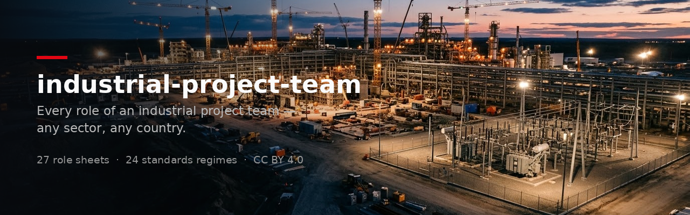

<p align="center">
  <a href="LICENSE.md"></a>
  <a href="LICENSE.md"></a>
  
  
</p>

**Ask any role of an industrial project team, and get a practitioner's answer instead of a textbook one.** Twenty-seven senior-level role sheets — project manager, cost controller, planner, contract manager, process, piping, electrical, HSE, commissioning, O&M and the rest — each with a reading grid to apply in order, indicative anchor figures, decision trees and the red flags a veteran hunts. The sector layer is **not shipped**: when your project belongs to one, the skill offers to write that profile with you. The country layer is worldwide: once the project country is defined, every role quotes the code set actually enforced there.

**→ [See what it actually answers](examples/sample-answers.md)** before installing anything.

## Install in 60 seconds

**claude.ai** (Pro, Max, Team, Enterprise) — enable *Code execution and file creation* in Settings, then upload the repository as a zip under *Customize › Skills* (Team / Enterprise: *Organization settings › Skills*). Or download the `.skill` file from the [latest release](../../releases/latest).

**Claude Code**
```bash
git clone https://github.com/j2globalpartners/industrial-project-team.git \
  ~/.claude/skills/industrial-project-team
```

Then just ask:
```
As the planner, read this schedule and tell me what does not hold.
Have the cost controller and the contract manager speak on this change order, then the PM's arbitration.
Simulate the FEED → detailed design gate review: who objects, on what.
Project in Poland, contractor posture: what changes for the contract manager?
Same plant in Texas: which codes does the piping engineer design to, and who inspects the vessels?
```

No dependencies: Markdown plus one standard-library Python script, no network access.

## What it is, and what it deliberately is not

| | A general-purpose answer | This skill |
|---|---|---|
| **Voice** | Neutral, consultant-flavoured | First person of the trade, with its vocabulary and its obsessions |
| **Document analysis** | Points noticed in the order they appear | The trade's reading grid, applied **in its own order** |
| **Figures** | Vague or invented | Anchor figures a senior keeps in mind, flagged as orders of magnitude |
| **Conclusion** | Reassuring summary | Ends on the red flags, by decreasing severity |
| **Sector** | Silently assumed | Named at the top; if no profile exists, the skill says so and offers to write it |
| **Standards** | Whatever the model knows best | The set enforced in the project country — 24 regimes mapped by discipline |
| **Posture** | Implicit | Owner / contractor / EPCM stated, because it inverts the contractual reading |
| **What it won't do** | — | Replace a calculation note, a regulatory text, or a qualified engineer's sign-off |

## Three layers

| Layer | Content | Shipped |
|---|---|---|
| **Generic roles** (`references/roles/`) | 27 sheets: how the role differs from its neighbours, reading grid, anchors, decision trees, red flags, the expert's eye | Yes |
| **Sector profiles** (`references/sectors/`) | What changes for each role in a sector: identity card, sector-specific roles, per-role inserts, country × sector notes | Only the fallback `generic` and the template — **every sector is created on demand** |
| **Countries** (`references/countries/`) | Nine axes that move at the border, a **worldwide map of technical standards regimes** by discipline (EU, UK, US, Canada, Australia/NZ, Gulf, India, China, Japan, Brazil, South Africa, international oil & gas, Norway, Switzerland, Turkey, Egypt, francophone and anglophone Africa, Singapore, Malaysia, Indonesia, South Korea, Mexico, Chile), five example country cards, substance risk | Yes |

An answer = role sheet(s) + the active profile's insert if it exists + the country layer once the country is defined. The role sheets are written code-agnostic: they quote standards by family, and the project country decides the set actually enforced — no regime is assumed by default.

The 27 roles: project manager, estimator, cost controller, planner, contract manager, risk manager, financing & FID; process, mechanical, materials & corrosion, piping, civil, geotechnical, electrical, instrumentation and DCS engineers; HSE, technical safety, environment & permitting; procurement, construction manager, quality, commissioning, O&M; grid & utility connection, interface manager, document control.

## Creating a sector profile

The skill ships no sector: it knows how to build one, with you, in three steps.

1. **Framing by questions** (ten minutes): object and scale, posture and contracts, gates, regulation and permits, dominant hazards, external counterparts, FID locks, revenue, roles to add or remove, countries. The skill does not guess in the practitioner's place.
2. **Writing the profile** in the order of `references/sectors/_template-sector.md`: identity card (twelve lines), sector-specific roles as compact sheets, one insert per role **only where the sector changes something**, country × sector notes, cross-cutting red flags.
3. **Installing it**: the file goes in `references/sectors/<slug>.md`, and `python scripts/team.py profile <slug>` must report zero orphan headings.

Five example profiles (solar PV, hydrogen, refining & petrochemicals, thermal power, manufacturing plant) sit in [`examples/sectors/`](examples/sectors/) — **unreviewed**, kept out of the shipped skill, there to show the expected density and to be corrected.

## Command-line tool

```
python scripts/team.py list                          catalogue roles, profiles, countries
python scripts/team.py profile <slug>                identity card + insert coverage
python scripts/team.py check [--config F]            catalogue / profile / configuration consistency
python scripts/team.py init --sector X --countries DE,FR --posture owner --phase FEED
python scripts/team.py new-sector <slug> --title "…"
python scripts/team.py new-role <slug> --title "…" (--family "…" | --sector-specific)
python scripts/team.py new-country IT --name "Italy"
```

`init` writes `project-team.json` at the root of a project folder — sector, countries, posture, phase, locks — and the skill reads it before answering (schema in `config/schema.md`). `check` also enforces the repository's own invariants: catalogue and profile headings aligned, one sheet per catalogue row, and no sector content leaking into the generic sheets.

## Structure

```
SKILL.md                       profile selection, role catalogue, answer protocol, sector creation
references/roles/              27 generic sheets + _template-role.md
references/sectors/            generic.md + _template-sector.md
references/countries/          multi-country.md, standards-regimes.md, country-cards.md, _template-country.md
config/                        project.json (default) and schema.md
scripts/team.py                command-line tool, no dependency
examples/                      sample answers + five unreviewed sector profiles
```

## Status and support

Version 1.0.0, first public edition, published 11 September 2026. It is used in production on the author's own projects, and maintained on that basis — not as a supported product. Issues and pull requests are read and answered; there is no service-level promise behind them.

Two honest caveats, also stated in the [changelog](CHANGELOG.md): the English of this first edition has not been proofread by a native speaker, and the standards regime map entries are reference points to be confirmed locally. Both are open to correction — see [CONTRIBUTING.md](CONTRIBUTING.md). Corrections from practitioners of a sector or a country are the contributions with the most value here.

## Disclaimer

The anchor figures are practitioners' orders of magnitude, **not design values**. This skill substitutes neither for a calculation note, nor for the opinion of a qualified engineer, nor for legal or financial advice. On safety (HAZOP, SIL, ATEX, Seveso, high voltage), it gives the method and the references, never a conclusion that would commit anyone.

## Author and licence

Written by **Jonathan Salomez** (J2 Global Partners), 25 years of EPC energy projects, from field practice. Banner and social image: AI-generated illustrations, typography by the author. The original role sheets were reviewed role by role with practitioners; this worldwide edition and its standards regime map are published for review.

Sheets and templates under **CC BY 4.0**, script under **MIT** — see [LICENSE.md](LICENSE.md). Attribution: *industrial-project-team — Jonathan Salomez, J2 Global Partners — CC BY 4.0*.
